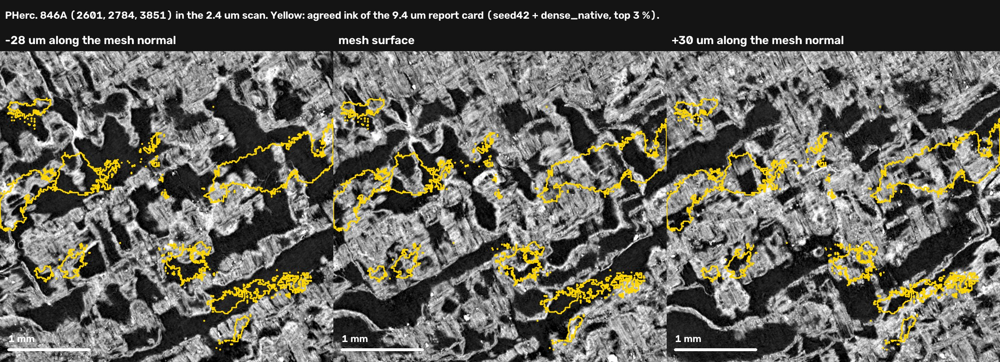
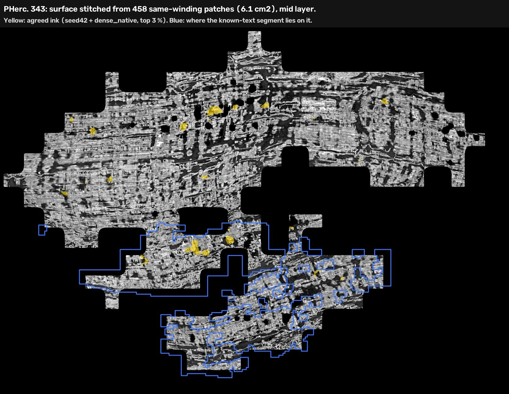
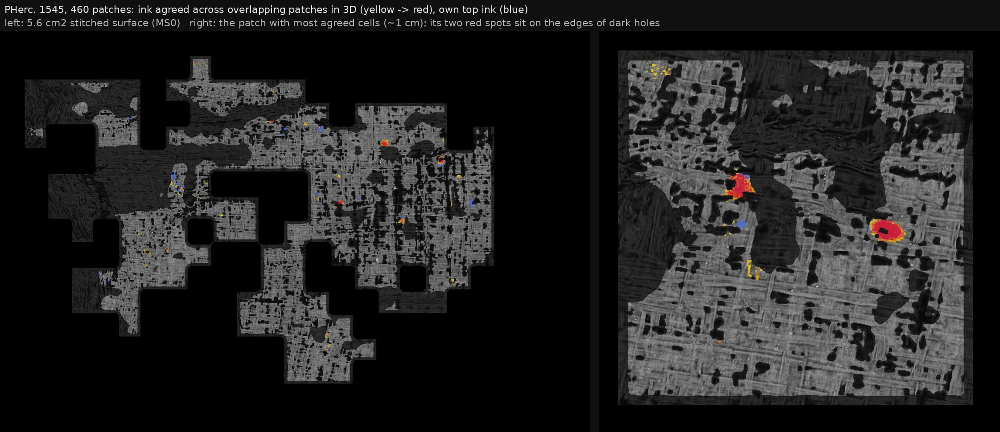

# Scroll Survey: a First Letters workflow on a laptop, plus sheet and ink diagnostics for the 21 First Letters scrolls

> "When I started on the challenge, finding which scrolls were worth reading meant unrolling one piece at a time and judging the ink pictures, and we got fooled by air gaps that looked like ink. So over a weekend I built a tool on my own laptop that scores it automatically." (ketchupbyheinz)

**What this is:** a small, tested toolkit that takes a scroll name and returns a scored *report card* for traced
papyrus patches, a survey of all 21 First Letters scrolls made with it, and a short list of leads that were followed
up. **No letters have been read.** The leads are places to look.

**New (31 Oct): ink that repeats across overlapping patches.** A 3D check keeps only model ink that independently
traced patches agree on at the same spot, with a control. On 460 PHerc. 1545 patches it finds 21x more agreement
than the control, but only about 5 mm² of round blobs, many on the edges of holes: no letters. Sorting patches into
windings did not hold up on this crushed scroll. See [3j](#3j-ink-that-repeats-across-overlapping-patches-inkvotepy).

**New (29 Oct): bigger surfaces on one winding.** A same-winding filter for VC3D's patch-and-stitch pipeline keeps
expansion patches on the seed's winding; on PHerc. 343 the stitched surface grew from 2.2 to 6.1 cm². See
[3i](#3i-bigger-surfaces-on-one-winding-patchsetpy).

**New (28 Oct): a sharp-scan check.** Where a scroll also has a 4x sharper 2.4 µm scan, the toolkit lines the two
scans up, carries a trace across and tests whether the ink models' "ink" sits on air gaps. It showed that this
survey's own top lead, PHerc. 846A (2765, 2952, 4205) and its strongest follow-up, is strongly tied to air gaps
between layers. See [3h](#3h-sharp-scan-check-sharpscanpy).

The report card addresses two items on the 2026 open-problems list: trace QA, and telling *no ink* apart from
*no ink recovered yet*.

1. **Is the trace on one sheet?** An automatic *sheet check* flags parts of a patch that cut across windings.
2. **Do the public ink models see writing here, or only texture?** Ink sits on one face of the sheet, so the card
   measures how one-sided the models' agreement is: *face asymmetry* (whole patch), *face consistency* (tile by
   tile), *which side* (inner or outer face of the roll) and a *crack check* (is the agreed ink sitting on dark
   voids in the CT?).
3. **Is the "ink" on papyrus or on air gaps?** Where a sharper scan exists, the *sharp-scan check* looks at the same
   spot at 2.4 µm.

Together these separate "the trace failed", "the models see nothing" and "the models see one-sided, letter-sized
ink on the side where text is written".

Everything streams from the open-data bucket; only the rendered patch is stored. On a Windows laptop with a 6 GB
RTX 3060, rendering and inking a ~4 cm² patch takes about 6 minutes on the GPU, and tracing it takes about 5
minutes on the CPU.


---

## Results

### 1. The renderer matches `vc_render_tifxyz`

`vesuvius_survey/render_patch.py` reimplements VC3D's default ("linear") surface-volume render in ~180 lines of
NumPy. It reads only the CT chunks a patch touches, straight from the bucket.

On a 600×600×28 render of a PHerc. 343 patch, compared with `vc_render_tifxyz` (VC3D 322cb08):
**99.6 % of voxels are identical, and every other voxel differs by 1 grey level** (correlation 0.999998).
The only difference is floating-point rounding. Reproduce with `docs/validate_renderer.sh`.

### 2. Sheet check (trace QA)

For each pixel of the flattened CT, a 12-orientation Gabor bank measures oriented texture energy. Papyrus seen
face-on shows two fibre families at ~90°, so the energy at the orthogonal orientation stays high (*crossness*).
A trace that slices through several windings shows one swirling flow direction, and crossness collapses.

| set | patches | median crossness |
|---|---|---|
| hand-judged good traces | 9 | 0.34 – 0.55 |
| hand-judged bad traces (cross-cuts) | 7 | 0.13 – 0.28 |

A threshold of 0.31 separates the two sets with no errors. The card paints each pixel green (on one sheet) or
red (cross-cut). `sheet_good_fraction` is the green share of the patch. In the survey tables a patch *passes the
sheet check* when at least 40 % of its 512 px tiles have median crossness of 0.31 or more (measured on the mesh's
quick-look render before inking).

### 3. Face asymmetry

Two public 9 µm models with different architectures and training histories run on both normal directions of
every patch:

* `seed42`: scrollprize/ink_9um hybrid_3d2d, step 75000
* `dnative`: Nieuwlaar/ink9um-dense-native, step 16000 (used for the PHerc. 343 First Letters win)

`agree_top3` is the overlap (IoU) of the two models' strongest 3 % of pixels on the green part of the patch.
Ink sits on one face of the sheet, while responses to fibre texture, cracks and voids tend to appear on both faces.
So `face_asymmetry = agree_top3(best face) / agree_top3(other face)` is expected to be higher where there is
writing.

| patch | known? | face asymmetry | letter-chain |
|---|---|---|---|
| PHerc. 343, Erwin Nieuwlaar's First Letters segment | text (positive control) | **3.2** (reading face picked correctly) | 1.89 |
| PHerc. 343, overlapping trace a few voxels inward (seed 5911, 4059, 10523) | same region | **4.0** | 1.85 |
| PHerc. 343, overlapping trace a few voxels outward (seed 4551, 3852, 10201) | same region | 1.54 | 1.15 |
| PHerc. 343, a few windings away (seed 5989, 4040, 10521) | not verified | 1.05 | 1.23 |
| PHerc. 343, elsewhere (seed 4937, 3336, 11593) | not verified | 1.02 | 1.26 |
| 78 survey patches in 20 of the 21 eligible scrolls | unknown | median 1.36, max 3.62 | — |

`letter-chain` measures how strongly letter-sized ink blobs line up along a fibre direction (1 = random).

### 3b. Face consistency (is the one-sided signal the same side everywhere?)

A whole-patch ratio can be pushed up by one bright corner. Writing sits on the same face in every part of the patch.
The card splits the patch into 768 px tiles (~7 mm, half-overlapping, at least half green). A tile is *strong* for a
face when the two models' IoU there (top-3 % thresholds taken over the whole patch) is above 0.1 and more than 3x the
other face's.

`face_consistency = (strong tiles on the majority face - strong tiles on the other face) / tiles`

When both faces have the same number of strong tiles the card reports `consistent_face: tie` and no side is named.

| patch | face consistency | face asymmetry |
|---|---|---|
| PHerc. 343 known-text segment (Nieuwlaar) | **0.52** (24 vs 0 of 46 tiles) | 3.2 |
| PHerc. 343, overlapping trace a few voxels inward | **0.77** (10 vs 0 of 13) | 4.0 |
| PHerc. 343, the three other patches | 0.00, 0.00, 0.00 | 1.02 – 1.54 |
| 78 survey patches (eligible scrolls) | median 0.14, max 0.67 | median 1.36, max 3.62 |

Across the survey patches there is a weak tendency for face consistency to be higher where less of the patch passes
the sheet check (Pearson r = -0.15; not significant on its own). Leads are still compared with patches of
similar sheet fraction.

### 3c. Which side of the sheet? (`side.py`)

Herculaneum rolls carry their writing on the inside face. `side.py` measures whether a patch's "forward" face points
towards the scroll centre (from the CT at that height) and turns the consistent face into **inner** or **outer**
(`unclear` for ties or when the patch faces sideways). Both known-text patches put their signal on the inner face.

A second, geometry-only estimate comes from the sheet's own curvature (normals of a rolled sheet converge towards the
axis). Over all patches where both estimates are clear they agree on 87 of 106 (survey patches
only: 41 of 52). They disagree on several PHerc. 846B patches, where the sheet is nearly flat;
side calls there are uncertain.

### 3d. Crack check

Voids, cracks and gaps between layers are dark in the CT and can trigger ink models. `ink_on_dark` is the share of
the agreed-ink pixels that fall on the darkest 10 % of the green CT (chance = 0.10). Known text: 0.09 and 0.11.
Survey patches: median 0.14.

In the sharp-scan check (3h) the three patches with a gap signal have 0.16 to 0.24 and the one without 0.13 (survey
median 0.14): consistent with this score, but too few to set a threshold.

### 3e. Neighbour-winding test (`vesuvius_survey.neighbours`)

For a lead, seeds are placed 15, 30 and 45 voxels along the normal on both sides of its most face-consistent tile,
snapped to the surface prediction, and traced and scored like any other patch. For two leads a wider ring was added
(60, 75, 90 voxels, and 500 voxels sideways along the sheet; `analysis/lateral_seeds.py`).

Text often continues onto neighbouring windings, so a lead whose neighbours repeat the inner-face signal is stronger.
It is not required: on PHerc. 343, of two traces that overlap the known-text segment a few voxels inward and outward
(4 to 9 voxels, so possibly the same sheet at a slightly different depth), one scores high and one scores flat.

For PHerc. 846A the follow-ups also include a second ring of ±15/30/45 voxels around the best tile of its strongest
follow-up (2601, 2784, 3851), which contains two near-same-sheet re-traces.

### 3f. More models

`seed43` (same architecture as `seed42`, other training seed) and Hecate 9.6 µm were run on the strongest patches.
Ratio of each model pair's top-3 % agreement on the inner face to that on the outer face (green pixels, d = 0):

| patch | seed42 / dense_native | seed42 / seed43 | dense_native / seed43 | seed42 / hecate | dense_native / hecate | seed43 / hecate |
|---|---|---|---|---|---|---|
| PHerc. 343 known text (Nieuwlaar segment) | 3.23 | 3.72 | 4.17 | 4.29 | 3.23 | 4.44 |
| PHerc. 1545 (3051, 3484, 14673) | 2.48 | 0.88 | 3.81 | 2.09 | 0.76 | 2.61 |
| PHerc. 1545 (3499, 4074, 9431) | 5.12 | 2.31 | 3.80 | 4.36 | 3.63 | 3.58 |
| PHerc. 846A (2601, 2784, 3851) | 5.55 | 2.62 | 3.09 | 8.88 | 2.66 | 4.64 |
| PHerc. 846A (2765, 2952, 4205) | 3.62 | 1.87 | 1.30 | 5.80 | 3.30 | 1.42 |
| PHerc. 846B (3962, 4983, 7051) | 4.05 | 1.52 | 2.53 | 2.40 | 1.61 | 3.69 |
| PHerc. 846B (3962, 5005, 7030) | 3.55 | 0.81 | 2.10 | — | — | — |

Per-patch values: [`results/leads/`](results/leads).

A depth sweep was run on the strongest PHerc. 846A follow-up with a 44-layer render (`render_patch --layers 44`) and
seed42, dense_native and seed43 at 17 depths d = -8 … +8 (Hecate not included): the share of reading-face pixels
with ensemble z > 2 peaks at d = 0 to +2 (about 0.03) and falls to 0.006 – 0.012 at |d| = 8, while the other face
stays near 0.01 at all depths (highest, 0.013, at d = 0 to +1). `results/leads/depth_sweep_*.json`.

### 3g. Leads

Every lead that was followed up, with all the patches traced around it. Patches whose two faces tie are counted as
*unclear*. No pass/fail rule is applied; the numbers are the evidence.

| lead (first patch) | first patch: asym / consistency / side / ink on dark | follow-up patches scored | side: inner / outer / unclear | median asym | median consistency | median ink on dark | best follow-up (asym / consistency / ink on dark) |
|---|---|---|---|---|---|---|---|
| PHerc. 846A (2765, 2952, 4205) | 3.62 / 0.50 / inner / 0.16 | 17 | 15 / 2 / 0 | 1.68 | 0.25 | 0.15 | 5.55 / 0.64 / 0.24 |
| PHerc. 846B (3561, 4951, 6961) | 1.47 / 0.67 / inner / 0.23 | 14 | 10 / 3 / 1 | 1.69 | 0.28 | 0.17 | 4.05 / 0.61 / 0.25 |
| PHerc. 1545 (3499, 4074, 9431) | 5.12 / 0.31 / inner / 0.19 | 6 | 4 / 1 / 1 | 1.90 | 0.19 | 0.15 | 4.15 / 0.38 / 0.15 |
| PHerc. 306B (2473, 4325, 7949) | 1.44 / 0.55 / outer / 0.15 | 2 | 0 / 2 / 0 | 1.72 | 0.18 | 0.11 | 1.89 / 0.29 / 0.08 |
| PHerc. 813 (4779, 5850, 8497) | 1.24 / 0.46 / inner / 0.11 | 4 | 2 / 1 / 1 | 1.91 | 0.16 | 0.19 | 2.37 / 0.50 / 0.11 |
| PHerc. 846A (1866, 4064, 7009) | 1.66 / 0.46 / inner / 0.19 | 5 | 1 / 0 / 4 | 1.48 | 0.14 | 0.12 | 1.63 / 0.57 / 0.10 |
| PHerc. 257 (3549, 4692, 13210) | 1.61 / 0.43 / inner / 0.14 | 6 | 3 / 3 / 0 | 1.58 | 0.25 | 0.16 | 2.51 / 0.23 / 0.15 |
| PHerc. 211 (3449, 4349, 9706) | 2.25 / 0.15 / inner / 0.16 | 20 | 11 / 7 / 2 | 1.66 | 0.22 | 0.13 | 1.94 / 0.61 / 0.11 |

The PHerc. 211 lead (the first lead of this project) was also checked with seed43 on CPU on one follow-up patch (3186, 4545, 9432): seed43 did not prefer either face with dense_native (1.06x).

The sharp-scan check (3h) later showed the signal of the PHerc. 846A (2765, 2952, 4205) lead and its strongest
follow-up to be strongly tied to air gaps between layers. The second PHerc. 846A lead (1866, 4064, 7009) was not
checked. The PHerc. 1545 (3051, 3484, 14673) follow-up is also in 3h.

### 3h. Sharp-scan check (`sharpscan.py`)

Of the 21 First Letters scrolls, PHerc. 846A and PHerc. 1203 also have a 2.4 µm scan (77 keV, 0.2 m), four times
sharper than the 9.4 µm scan used for the survey. At 2.4 µm the papyrus fibres and the air gaps between layers are
directly visible, so the same place can be checked: does the card's agreed ink fall on papyrus or on gaps?

**Lining the scans up.** In both scrolls the two scans are aligned in x and y to within 0.2 mm in physical units, with
no rotation; only the height offset is unknown. A whole-section match finds it (846A at ~75 µm: score 0.997; 1203 at
~150 µm with the packaged code: score 0.987), and a local match at ~19 µm refines it around each patch (scores 0.87
to 0.95). The 846A seed, carried across, lands 1 voxel from the 2.4 µm surface prediction.
`results/sharpscan/registration.json`.

**The check.** The patch mesh is carried across (`sharpscan map`) and rendered on the 2.4 µm scan at 4.8 µm pixels,
32 layers (±77 µm along the mesh normal). In every layer the darkest quarter of pixels counts as gap. For the card's
agreed ink (seed42 and dense_native both in their top 3 %, on sheet-check pixels) the check divides the gap share
under the ink by the gap share elsewhere on the patch, separately for the −normal and +normal halves of the stack,
and repeats this for 48 shifted copies of the ink mask as controls. A ratio of 1 means no link with gaps.

| patch | card: asym / consistency / ink on dark (ink face) | gap ratio, −normal half (shifted copies below it) | gap ratio, +normal half |
|---|---|---|---|
| PHerc. 846A (2601, 2784, 3851), the strongest follow-up | 5.55 / 0.64 / 0.24 (reverse) | **2.50** (48 of 48; shifted median 1.03) | 1.14 (35 of 48) |
| PHerc. 846A (2765, 2952, 4205), the survey patch | 3.62 / 0.50 / 0.16 (reverse) | **1.82** (47 of 48; shifted median 0.95) | 0.97 (24 of 48) |
| PHerc. 1203 (3405, 4529, 9488), side: outer | 2.08 / 0.33 / 0.17 (reverse) | **1.73** (47 of 48; shifted median 0.94) | 1.32 (41 of 48) |
| PHerc. 1203 (1894, 3594, 9489) | 1.36 / 0.13 / 0.13 (forward) | 0.95 (27 of 48) | 0.89 (25 of 48) |



**846A, traced again in the sharp scan.** The same sheet, traced directly in the 2.4 µm scan (seed carried across,
9.85 cm²) and inked at 9.6 µm with the same two models, scores 1.63 / 0.29 / 0.11: far below the 5.55 / 0.64 of the
9.4 µm trace, though still above the survey median (1.36 / 0.14). `results/sharpscan/sharp_trace_846A.json`.

**What this shows.** On both PHerc. 846A patches and on the stronger PHerc. 1203 patch, the agreed ink falls on gaps
1.7 to 2.5 times as often as elsewhere on the patch (shifted copies: about 1.0), on the −normal half, which in all
three is the half on the card's ink face (`reverse`); the +normal half shows less (0.97 to 1.32). So the 846A signal
is largely explained by gaps between layers rather than writing. The card's crack score agrees: 0.16 to 0.24 for the
three patches with a gap signal, 0.13 for the one without (which has no ink signal to begin with). Four patches are
too few to set a threshold, and no known-text segment exists in a sharp scan yet, so a positive control is missing.

**PHerc. 1545 (3051, 3484, 14673).** Among survey patches with a low crack score, the most writing-like is this one:
face consistency 0.64 (known text 0.52 and 0.77), ink on dark 0.13, ink on solid papyrus. It was followed up:
4 of 6 model pairs prefer its inner face (2.1x to 3.8x; seed42 / seed43 0.88x, dense_native / Hecate 0.76x). Of six
neighbour traces, three passed or nearly passed the sheet check and were inked; at −15 and −30 voxels they score
flat, at −45 voxels 2.11 / 0.25 / 0.09, and none has a clear side. Grown from the same seed to 12.1 cm², the trace
stays on one sheet only in a diagonal band (sheet fraction 0.46) and the whole surface scores flat (1.09 / 0.03).
No letter rows are visible. `results/leads/followup_PHerc1545_3051_3484_14673.json`.

The patches in this section (the 846A sharp-scan trace, the 1545 neighbours and the 12.1 cm² trace) are not in
`results/survey.json` or the counts above; their cards and meshes are in `results/cards/` and `results/meshes/`.

### 3i. Bigger surfaces on one winding (`patchset.py`)

VC3D builds large surfaces from many small patches: expansion mode (`vc_grow_seg_from_seed`, `"mode": "expansion"`)
grows new patches from random points of the existing ones, and `vc_grow_seg_from_segments` stitches them by letting
overlapping patches vote. Tested on PHerc. 343, starting from the trace that overlaps the known-text segment
(3.48 cm²), this stalls: the stitched surface stays at 2.17 cm².

**Why.** PHerc. 343 is tightly rolled. Measured along the seed patch's normals, the 192 expansion patches sit in
layers at roughly 0, ±12 and ±32 voxels: neighbouring windings (or the other face of the sheet) about 0.1 mm apart.
Once a patch is on a neighbouring winding, every patch seeded from it is too. Of 194 patches only 36 (19 %) stayed on
the seed's winding; of 901 grown on the laptop, 137 (15 %). The stitcher cannot find agreeing patches on any one sheet.

**Same-winding filter.** Starting from the seed, a patch whose overlap with the accepted patches has a median offset
below 4 voxels along their normals is accepted; one that overlaps them further away is rejected and moved out of the
folder, so expansion stops seeding from it and the stitcher never sees it; patches that overlap nothing accepted yet
stay undecided. `patchset steer` alternates rounds of expansion patches with this filter, and a `gate` subcommand
tags patches that fail the card's sheet check `"defective"` (the stitcher skips them; 6 of 194 here).

| run | patches on the seed's winding | stitched surface (counted mesh nodes) |
|---|---|---|
| seed patch alone | 1 | 3.48 cm² |
| 194 unsteered expansion patches, all stitched | 36 | 2.17 cm² |
| 10 steered rounds in the cloud, same-winding patches only | 118 | 4.13 cm² (stopped: out of memory) |
| 45 steered rounds on the laptop | 458 | 6.09 cm² (stitcher plateaued; last snapshot) |

In the laptop run undecided patches were still allowed to seed new ones, and many of those families turned out to be
a winding away (batches of 257 and 44 rejected when they linked up): only about a quarter of the steered patches
landed on the seed's winding (cloud run: about half). `patchset steer` now parks undecided patches between rounds,
so new patches grow only from accepted ones.

**Report card of the 6.1 cm² stitched surface:** face consistency 0.50 (7 vs
1 of 12 tiles), face asymmetry 1.94, letter-chain
2.06 (other face 1.67), ink on dark 0.14, sheet check
0.51. The known-text segment covers 18 % of it; the agreed ink is 2.6x denser there than on
the rest. No letters are legible: the stitcher stretches the surface in places, and these two models give blobs
rather than letter shapes even on the known-text segment. `results/stitch343/summary.json`.



### 3j. Ink that repeats across overlapping patches (`inkvote.py`)

A traced patch is one guess at where the sheet is, and the ink models give one guess at where the ink is. Where
several patches were traced independently over the same papyrus, real ink should sit at the same 3D spot in every
one of them; model noise and crack hits move around. `inkvote vote` checks exactly that:

1. **Cracks out first.** Off-sheet pixels (card sheet check) and the darkest 15 % of on-sheet CT (after a light blur,
   grown by 5 px) are left out before ranking.
2. **Both models must agree.** seed42 and dense_native become percentile ranks within the patch; a pixel counts as top
   ink when both are in their top 3 %.
3. **Same spot in 3D.** Every pixel is mapped to 3D through its mesh and dropped into a 6-voxel cube. Per cube: how
   many patches pass through it and in how many of them it is top ink. A cube is *agreed* when at least 3 patches
   cover it and on average at least half of their samples there are top ink. Patches on different windings do not
   share cubes, so nothing has to be sorted into windings first.
4. **Control.** The same vote with every patch's ink map turned 180 degrees on its own surface: same maps, same
   statistics, 3D alignment destroyed. The two faces of the sheet are kept apart (patch normals are made to agree
   through their overlaps).

**PHerc. 1545, 460 patches** (picked from 1,060 expansion patches around (3051, 3484, 14673) to cover the area about 3
times over, which 58 % of it reached; 28-layer renders, seed42 + dense_native on the laptop, ~1.6 min per patch):

| face | agreed cubes | turned-map control | ratio |
|---|---|---|---|
| back | 1,780 | 84 | 21x |
| front | 500 | 70 | 7x |

So some model ink does repeat in 3D, far above the control. But it is very little: about 5 mm² in total over roughly
34 cm² of covered sheet (cube count, overlapping windings counted separately), as round blobs 0.5 to 1 mm across, and
on the patches with the most agreed cubes the strongest blobs sit on the edges of dark holes in the papyrus. Letters
would show as 2 to 3 mm strokes in lines; nothing like that is there. `results/inkvote1545/vote3d.json`.



**Sorting patches into windings did not work on this scroll.** PHerc. 1545 is crushed flat (a lens about 50 x 28 mm
in cross-section), and its windings touch. The 1,060 patches that the 4-voxel same-winding filter (3i) accepted turn
out to spread over many windings: where windings touch, acceptance creeps from one to the next in small steps. Two
replacements were tried and both fail checks on the full set (`results/inkvote1545/sorting_checks.json`):

* *Integer winding numbers* from tile overlaps (~1 mm tiles; 0 = same sheet, one spacing = next winding): only 46 % of
  the overlap links (62 % weighted) agree with the final numbers; the gap between windings varies too much.
* *Same-sheet grouping* (join pieces that lie on top of each other, never join groups seen clearly apart): 2,438
  groups, and only 19 % of the same-sheet pairs (38 % weighted) end up in one group.

The grouping is in `patchset winding` as an experimental option; `patchset steer` keeps the 3i filter by default.
The 3D vote above needs neither. The stitched surfaces were affected too: on 1545, two stitched surfaces overlapping
each other lie on the same sheet over only 21 % to 81 % of the overlap, the rest 8 to 24 voxels apart.

### 4. Survey of the 21 First Letters scrolls

Survey patches only (first-pass seeds at several heights per scroll; lead follow-ups are counted separately).

| scroll | survey patches traced | pass sheet check | inked | best face asymmetry (seed x, y, z) | best face consistency (seed x, y, z) | follow-up patches |
|---|---|---|---|---|---|---|
| PHerc. 125 | 9 | 9 | 9 | 2.03 (5409, 5288, 14587) | 0.31 (3598, 3475, 14587) | — |
| PHerc. 175A | 6 | 6 | 6 | 1.90 (6060, 6360, 8923) | 0.44 (3327, 3628, 8923) | — |
| PHerc. 175B | 9 | 0 | 0 | — | — | — |
| PHerc. 191 | 5 | 1 | 1 | 1.49 (2301, 3300, 9499) | 0.38 (2301, 3300, 9499) | — |
| PHerc. 211 | 2 | 2 | 2 | 2.25 (3449, 4349, 9706) | 0.15 (3449, 4349, 9706) | 21 |
| PHerc. 257 | 9 | 5 | 5 | 1.61 (3549, 4692, 13210) | 0.43 (3549, 4692, 13210) | 6 |
| PHerc. 268 | 9 | 1 | 1 | 1.35 (9054, 2867, 6674) | 0.08 (9054, 2867, 6674) | — |
| PHerc. 306B | 6 | 4 | 4 | 1.74 (3802, 3034, 11128) | 0.55 (2473, 4325, 7949) | 4 |
| PHerc. 358 | 6 | 5 | 5 | 1.92 (2358, 2561, 4423) | 0.36 (4001, 5452, 7369) | — |
| PHerc. 483A | 6 | 5 | 5 | 1.45 (5050, 5380, 4769) | 0.31 (2970, 3300, 4769) | — |
| PHerc. 483B | 6 | 3 | 3 | 1.41 (5293, 5712, 3564) | 0.18 (1681, 4537, 5940) | — |
| PHerc. 490A | 6 | 2 | 2 | 1.19 (5837, 6382, 8186) | 0.12 (5837, 6382, 8186) | — |
| PHerc. 490B | 6 | 3 | 3 | 1.42 (3221, 3223, 3194) | 0.17 (5471, 5473, 3194) | — |
| PHerc. 800 | 6 | 4 | 4 | 2.36 (6703, 5799, 7289) | 0.31 (2596, 5328, 12147) | — |
| PHerc. 813 | 6 | 4 | 4 | 2.96 (3131, 2667, 11895) | 0.46 (4779, 5850, 8497) | 6 |
| PHerc. 826 | 6 | 3 | 3 | 1.25 (3234, 4358, 11844) | 0.21 (3234, 4358, 11844) | — |
| PHerc. 846A | 6 | 5 | 5 | 3.62 (2765, 2952, 4205) | 0.50 (2765, 2952, 4205) | 23 |
| PHerc. 846B | 6 | 4 | 4 | 1.47 (3561, 4951, 6961) | 0.67 (3561, 4951, 6961) | 15 |
| PHerc. 1203 | 6 | 3 | 3 | 2.08 (3405, 4529, 9488) | 0.33 (3405, 4529, 9488) | — |
| PHerc. 1218 | 6 | 4 | 4 | 1.54 (3888, 5032, 11620) | 0.25 (3888, 5032, 11620) | — |
| PHerc. 1545 | 6 | 5 | 5 | 2.48 (3051, 3484, 14673) | 0.64 (3051, 3484, 14673) | 6 |

Full table, including the follow-ups, the controls and one extra PHerc. 1545 patch made by the Windows end-to-end
test: [`results/survey.csv`](results/survey.csv) (`sample` column). Every report card:
[`results/cards/`](results/cards) (JPEG + JSON). Every traced mesh, ready for VC3D (*File → Attach Segments*):
[`results/meshes/`](results/meshes).

**Takeaways**

* **Coverage.** 133 survey patches were traced in the 21 eligible scrolls; 78 pass the sheet check and
  78 were inked, in 20 scrolls. No PHerc. 175B trace passed the sheet check (0 of 9) and few PHerc. 268
  traces did (1 of 9). Another 81 patches were traced to follow up leads, plus one PHerc. 1545 patch
  from the Windows end-to-end test.
* **What known text looks like, and its limits.** On PHerc. 343 the known-text segment and an overlapping trace a few
  voxels inward score high on both ink scores, with the signal on the inner face. An overlapping trace a few voxels
  outward, a patch a few windings away and a patch elsewhere score flat. A flat card means "nothing found here",
  not "nothing in this scroll", and a trace over real text can still score flat.
* **Most survey patches look like blank papyrus to these models.** Survey medians: face asymmetry 1.36
  (known text 3.2 and 4.0), face consistency 0.14 (known text 0.52 and 0.77).
* **The strongest-looking lead was largely air gaps.** One survey patch, PHerc. 846A at (2765, 2952, 4205), scores
  like the known text on both ink scores, its follow-ups mostly agree (15 of 17 inner face), and its strongest
  follow-up (2601, 2784, 3851) beats the known text on face asymmetry (5.55), though with a high crack score (0.24).
  The 2.4 µm scan settles it: on both patches the agreed ink falls on gaps between layers 1.8 to 2.5 times as often
  as elsewhere, and the same sheet traced again in the sharp scan scores far lower (1.63 / 0.29). This lead is
  dropped.
* **Read the crack score next to the ink scores.** On the four sharp-scan patches it was consistent with the check
  (0.16 to 0.24 with a gap signal, 0.13 without; survey median 0.14). The other earlier leads with high ink scores
  also have raised crack scores: PHerc. 846B (its patches lean on dark CT) and the PHerc. 1545 Windows-test patch
  (0.19). PHerc. 211 had already been dropped: its neighbouring windings flip sides and seed43 does not confirm it.
* **The most writing-like low-crack patch is PHerc. 1545 at (3051, 3484, 14673)** (consistency 0.64, crack score
  0.13), but it does not hold up beyond its own 4 cm²: 4 of 6 model pairs agree, its neighbours score flat or show
  no clear side, and grown to 12 cm² it scores flat. **No letters can be read yet.**
* **What to do with this.** Run the card on any new trace (~6 minutes on a laptop GPU once traced) and read the crack
  score next to the two ink scores; where a sharper scan exists, run the sharp-scan check before spending time on a
  patch. The traces here are ~4 cm² auto-grown patches, and grown larger they drift across windings: clean, large
  single-sheet surfaces are what a First Letters attempt needs next.

---

## Use it

### Windows (tested: RTX 3060 Laptop 6 GB, Windows 10)

```
windows\setup.bat              one time: Python env, PyTorch CUDA, villa, VC3D release (10-20 min)
windows\survey.bat PHerc1545   trace + render + 2 ink models + card for 2 patches at mid-height
```

Options are passed through, for example `windows\survey.bat PHerc0211 --z 0.3 0.5 0.7 --n 4`.
In the end-to-end test on the laptop, one patch (trace, 28-layer render, both models on both faces, card) took 18
minutes while the GPU was also running other jobs.

For long runs, `windows\worker_watch.py` is the queue worker used for this survey: it renders and inks every traced
patch dropped into `work\survey\`, and runs depth sweeps (`work\deep\<patch>\job.json`, models x depths,
including Hecate) on request.

### Linux / any Python

```
pip install -e /path/to/villa/vesuvius --no-deps  &&  pip install -e .
python -m vesuvius_survey.survey --scroll PHerc0211 --out work --vc "VC3D.AppImage vc_grow_seg_from_seed"
```

Each step also works on its own:

| module | does |
|---|---|
| `trace` | looks up a scroll's CT and surface prediction in the bucket and grows a patch with `vc_grow_seg_from_seed`, using the remote normal grids so the trace stays on one sheet |
| `seeds` | automatic seed points on the predicted surface at a given height and radius |
| `render_patch` | streaming surface-volume render (matches `vc_render_tifxyz`, see above), resumable; `--level` / `--coord-mult` render on another multiscale level |
| `ink` | downloads and sha256-checks both models, runs them on both faces |
| `inkcheck`, `textchain` | sheet check, agreement and letter-chain scores |
| `report_card` | the card (PNG + JSON): sheet check, face asymmetry, face consistency, crack check, letter-chain |
| `side` | inner/outer face from the scroll centre, plus the curvature cross-check |
| `neighbours` | seeds on the windings either side of a lead's best tile |
| `patchset` | keep VC3D's patch-and-stitch pipeline on one winding: `same-winding` filter, experimental `winding` (same-sheet grouping), sheet-check `gate`, steered expansion rounds (`steer`), time-limited `stitch`, local `stub` volume for the stitcher |
| `inkvote` | ink that repeats across overlapping patches: crack mask, two-model agreement, 6-voxel 3D cubes, turned-map control, pictures (`vote`); picks patches for even coverage and queues them for the laptop worker (`queue`) |
| `sharpscan` | lines a 9 µm scan up with a sharper one, carries a mesh across, and checks whether agreed ink sits on gaps (`register`, `map`, `gapcheck`) |

`analysis/` holds the scripts that built the tables (they use the run machine's paths and folder layout; see
`analysis/README.md`), all seed lists, the sheet grades and the per-patch side, curvature and crack-check values.

## Limitations (please read before trusting a lead)

* A high score is a **pointer**, not a reading. The positive controls come from one scroll (PHerc. 343), and a
  trace overlapping the known text a few voxels outward scores flat.
* The survey uses two models, one 17-layer window and ~4 cm² per patch. A scroll that scores flat here may still
  have ink elsewhere, or ink these models cannot see.
* The sheet-check threshold was set on 16 hand-judged patches.
* Neighbouring windings share geometry, so their inner/outer calls are not independent.
* seed43 run on CPU (cloud) and on GPU (laptop) gives maps that correlate at 0.86, not 1.0. The model-pair ratios
  above come from the laptop GPU runs; the PHerc. 211 remark in the leads table comes from a CPU run.
* Tracing depends on the published surface prediction: no PHerc. 175B trace passed the sheet check (0 of 9).
* The same-winding filter was tested on one scroll (PHerc. 343); its 4-voxel threshold assumes windings at least ~10
  voxels apart. The stitched surface is distorted in places.
* The sharp-scan check needs a second, sharper scan: of the 21 scrolls only PHerc. 846A and 1203 have one. It was run
  on four patches, and there is no known-text positive control in a sharp scan yet.
* Two of the seven PHerc. 343 control seeds did not give a usable trace.
* The 3D ink vote was run on one area of one scroll (PHerc. 1545, around (3051, 3484, 14673)); it has not yet been
  run on known text, so how many agreed cubes letters would give is not measured. Its 6-voxel cubes cannot separate
  windings closer than that, which happens where 1545's windings touch.
* On PHerc. 1545 the same-winding filter (3i) crept across touching windings; its 1,060 "same-winding" patches are not
  one winding.

## Credits

Built on the Vesuvius Challenge open data, villa (VC3D, `vesuvius.ink_detection`), the public ink models by the
Vesuvius Challenge team and Erwin Nieuwlaar, and Hecate. `windows/hecate_prep.py` is from Erwin Nieuwlaar's
PHerc. 343 repository (MIT). MIT licence for the code; derived data follow the open-data licence (CC BY-NC 4.0).
