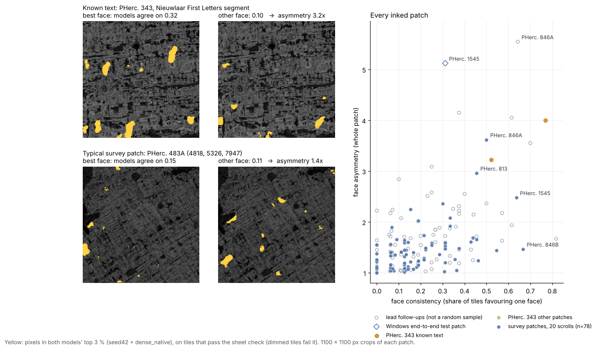

# Scroll Survey: a First Letters workflow on a laptop, plus sheet and ink diagnostics for the 21 First Letters scrolls

**What this is:** a small, tested toolkit that takes a scroll name and returns a scored *report card* for traced
papyrus patches, a survey of all 21 First Letters scrolls made with it, and a short list of leads that were followed
up. **No letters have been read.** The leads are places to look.

The report card addresses two items on the 2026 open-problems list: trace QA, and telling *no ink* apart from
*no ink recovered yet*.

1. **Is the trace on one sheet?** An automatic *sheet check* flags parts of a patch that cut across windings.
2. **Do the public ink models see writing here, or only texture?** Ink sits on one face of the sheet, so the card
   measures how one-sided the models' agreement is: *face asymmetry* (whole patch), *face consistency* (tile by
   tile), *which side* (inner or outer face of the roll) and a *crack check* (is the agreed ink sitting on dark
   voids in the CT?).

Together these separate "the trace failed", "the models see nothing" and "the models see one-sided, letter-sized
ink on the side where text is written".

Everything streams from the open-data bucket; only the rendered patch is stored. On a Windows laptop with a 6 GB
RTX 3060, rendering and inking a ~4 cm² patch takes about 6 minutes on the GPU, and tracing it takes about 5
minutes on the CPU.



---

## Results

### 1. The renderer matches `vc_render_tifxyz`

`vesuvius_survey/render_patch.py` reimplements VC3D's default ("linear") surface-volume render in ~180 lines of
NumPy. It reads only the CT chunks a patch touches, straight from the bucket.

On a 600×600×28 render of a PHerc. 343 patch, compared with `vc_render_tifxyz` (VC3D 322cb08):
**99.6 % of voxels are identical, and every other voxel differs by 1 grey level** (correlation 0.999998).
The only difference is floating-point rounding. Reproduce with `docs/validate_renderer.sh`.

### 2. Sheet check (trace QA)

For each pixel of the flattened CT, a 12-orientation Gabor bank measures oriented texture energy. Papyrus seen
face-on shows two fibre families at ~90°, so the energy at the orthogonal orientation stays high (*crossness*).
A trace that slices through several windings shows one swirling flow direction, and crossness collapses.

| set | patches | median crossness |
|---|---|---|
| hand-judged good traces | 9 | 0.34 – 0.55 |
| hand-judged bad traces (cross-cuts) | 7 | 0.13 – 0.28 |

A threshold of 0.31 separates the two sets with no errors. The card paints each pixel green (on one sheet) or
red (cross-cut). `sheet_good_fraction` is the green share of the patch. In the survey tables a patch *passes the
sheet check* when at least 40 % of its 512 px tiles have median crossness of 0.31 or more (measured on the mesh's
quick-look render before inking).

### 3. Face asymmetry

Two public 9 µm models with different architectures and training histories run on both normal directions of
every patch:

* `seed42`: scrollprize/ink_9um hybrid_3d2d, step 75000
* `dnative`: Nieuwlaar/ink9um-dense-native, step 16000 (used for the PHerc. 343 First Letters win)

`agree_top3` is the overlap (IoU) of the two models' strongest 3 % of pixels on the green part of the patch.
Ink sits on one face of the sheet, while responses to fibre texture, cracks and voids tend to appear on both faces.
So `face_asymmetry = agree_top3(best face) / agree_top3(other face)` is expected to be higher where there is
writing.

| patch | known? | face asymmetry | letter-chain |
|---|---|---|---|
| PHerc. 343, Erwin Nieuwlaar's First Letters segment | text (positive control) | **3.2** (reading face picked correctly) | 1.89 |
| PHerc. 343, overlapping trace a few voxels inward (seed 5911, 4059, 10523) | same region | **4.0** | 1.85 |
| PHerc. 343, overlapping trace a few voxels outward (seed 4551, 3852, 10201) | same region | 1.54 | 1.15 |
| PHerc. 343, a few windings away (seed 5989, 4040, 10521) | not verified | 1.05 | 1.23 |
| PHerc. 343, elsewhere (seed 4937, 3336, 11593) | not verified | 1.02 | 1.26 |
| 78 survey patches in 20 of the 21 eligible scrolls | unknown | median 1.36, max 3.62 | — |

`letter-chain` measures how strongly letter-sized ink blobs line up along a fibre direction (1 = random).

### 3b. Face consistency (is the one-sided signal the same side everywhere?)

A whole-patch ratio can be pushed up by one bright corner. Writing sits on the same face in every part of the patch.
The card splits the patch into 768 px tiles (~7 mm, half-overlapping, at least half green). A tile is *strong* for a
face when the two models' IoU there (top-3 % thresholds taken over the whole patch) is above 0.1 and more than 3x the
other face's.

`face_consistency = (strong tiles on the majority face - strong tiles on the other face) / tiles`

When both faces have the same number of strong tiles the card reports `consistent_face: tie` and no side is named.

| patch | face consistency | face asymmetry |
|---|---|---|
| PHerc. 343 known-text segment (Nieuwlaar) | **0.52** (24 vs 0 of 46 tiles) | 3.2 |
| PHerc. 343, overlapping trace a few voxels inward | **0.77** (10 vs 0 of 13) | 4.0 |
| PHerc. 343, the three other patches | 0.00, 0.00, 0.00 | 1.02 – 1.54 |
| 78 survey patches (eligible scrolls) | median 0.14, max 0.67 | median 1.36, max 3.62 |

Across the survey patches there is a weak tendency for face consistency to be higher where less of the patch passes
the sheet check (Pearson r = -0.15; not significant on its own). Leads are still compared with patches of
similar sheet fraction.

### 3c. Which side of the sheet? (`side.py`)

Herculaneum rolls carry their writing on the inside face. `side.py` measures whether a patch's "forward" face points
towards the scroll centre (from the CT at that height) and turns the consistent face into **inner** or **outer**
(`unclear` for ties or when the patch faces sideways). Both known-text patches put their signal on the inner face.

A second, geometry-only estimate comes from the sheet's own curvature (normals of a rolled sheet converge towards the
axis). Over all patches where both estimates are clear they agree on 87 of 106 (survey patches
only: 41 of 52). They disagree on several PHerc. 846B patches, where the sheet is nearly flat;
side calls there are uncertain.

### 3d. Crack check

Voids, cracks and gaps between layers are dark in the CT and can trigger ink models. `ink_on_dark` is the share of
the agreed-ink pixels that fall on the darkest 10 % of the green CT (chance = 0.10). Known text: 0.09 and 0.11.
Survey patches: median 0.14.

### 3e. Neighbour-winding test (`vesuvius_survey.neighbours`)

For a lead, seeds are placed 15, 30 and 45 voxels along the normal on both sides of its most face-consistent tile,
snapped to the surface prediction, and traced and scored like any other patch. For two leads a wider ring was added
(60, 75, 90 voxels, and 500 voxels sideways along the sheet; `analysis/lateral_seeds.py`).

Text often continues onto neighbouring windings, so a lead whose neighbours repeat the inner-face signal is stronger.
It is not required: on PHerc. 343, of two traces that overlap the known-text segment a few voxels inward and outward
(4 to 9 voxels, so possibly the same sheet at a slightly different depth), one scores high and one scores flat.

For PHerc. 846A the follow-ups also include a second ring of ±15/30/45 voxels around the best tile of its strongest
follow-up (2601, 2784, 3851), which contains two near-same-sheet re-traces.

### 3f. More models

`seed43` (same architecture as `seed42`, other training seed) and Hecate 9.6 µm were run on the strongest patches.
Ratio of each model pair's top-3 % agreement on the inner face to that on the outer face (green pixels, d = 0):

| patch | seed42 / dense_native | seed42 / seed43 | dense_native / seed43 | seed42 / hecate | dense_native / hecate | seed43 / hecate |
|---|---|---|---|---|---|---|
| PHerc. 343 known text (Nieuwlaar segment) | 3.23 | 3.72 | 4.17 | 4.29 | 3.23 | 4.44 |
| PHerc. 1545 (3499, 4074, 9431) | 5.12 | 2.31 | 3.80 | 4.36 | 3.63 | 3.58 |
| PHerc. 846A (2601, 2784, 3851) | 5.55 | 2.62 | 3.09 | 8.88 | 2.66 | 4.64 |
| PHerc. 846A (2765, 2952, 4205) | 3.62 | 1.87 | 1.30 | 5.80 | 3.30 | 1.42 |
| PHerc. 846B (3962, 4983, 7051) | 4.05 | 1.52 | 2.53 | 2.40 | 1.61 | 3.69 |
| PHerc. 846B (3962, 5005, 7030) | 3.55 | 0.81 | 2.10 | — | — | — |

Per-patch values: [`results/leads/`](results/leads).

A depth sweep was run on the strongest PHerc. 846A follow-up with a 44-layer render (`render_patch --layers 44`) and
seed42, dense_native and seed43 at 17 depths d = -8 … +8 (Hecate not included): the share of reading-face pixels
with ensemble z > 2 peaks at d = 0 to +2 (about 0.03) and falls to 0.006 – 0.012 at |d| = 8, while the other face
stays near 0.01 at all depths (highest, 0.013, at d = 0 to +1). `results/leads/depth_sweep_*.json`.

### 3g. Leads

Every lead that was followed up, with all the patches traced around it. Patches whose two faces tie are counted as
*unclear*. No pass/fail rule is applied; the numbers are the evidence.

| lead (first patch) | first patch: asym / consistency / side / ink on dark | follow-up patches scored | side: inner / outer / unclear | median asym | median consistency | median ink on dark | best follow-up (asym / consistency / ink on dark) |
|---|---|---|---|---|---|---|---|
| PHerc. 846A (2765, 2952, 4205) | 3.62 / 0.50 / inner / 0.16 | 17 | 15 / 2 / 0 | 1.68 | 0.25 | 0.15 | 5.55 / 0.64 / 0.24 |
| PHerc. 846B (3561, 4951, 6961) | 1.47 / 0.67 / inner / 0.23 | 14 | 10 / 3 / 1 | 1.69 | 0.28 | 0.17 | 4.05 / 0.61 / 0.25 |
| PHerc. 1545 (3499, 4074, 9431) | 5.12 / 0.31 / inner / 0.19 | 6 | 4 / 1 / 1 | 1.90 | 0.19 | 0.15 | 4.15 / 0.38 / 0.15 |
| PHerc. 306B (2473, 4325, 7949) | 1.44 / 0.55 / outer / 0.15 | 2 | 0 / 2 / 0 | 1.72 | 0.18 | 0.11 | 1.89 / 0.29 / 0.08 |
| PHerc. 813 (4779, 5850, 8497) | 1.24 / 0.46 / inner / 0.11 | 4 | 2 / 1 / 1 | 1.91 | 0.16 | 0.19 | 2.37 / 0.50 / 0.11 |
| PHerc. 846A (1866, 4064, 7009) | 1.66 / 0.46 / inner / 0.19 | 5 | 1 / 0 / 4 | 1.48 | 0.14 | 0.12 | 1.63 / 0.57 / 0.10 |
| PHerc. 257 (3549, 4692, 13210) | 1.61 / 0.43 / inner / 0.14 | 6 | 3 / 3 / 0 | 1.58 | 0.25 | 0.16 | 2.51 / 0.23 / 0.15 |
| PHerc. 211 (3449, 4349, 9706) | 2.25 / 0.15 / inner / 0.16 | 20 | 11 / 7 / 2 | 1.66 | 0.22 | 0.13 | 1.94 / 0.61 / 0.11 |

The PHerc. 211 lead (the first lead of this project) was also checked with seed43 on CPU on one follow-up patch (3186, 4545, 9432): seed43 did not prefer either face with dense_native (1.06x).

### 4. Survey of the 21 First Letters scrolls

Survey patches only (first-pass seeds at several heights per scroll; lead follow-ups are counted separately).

| scroll | survey patches traced | pass sheet check | inked | best face asymmetry (seed x, y, z) | best face consistency (seed x, y, z) | follow-up patches |
|---|---|---|---|---|---|---|
| PHerc. 125 | 9 | 9 | 9 | 2.03 (5409, 5288, 14587) | 0.31 (3598, 3475, 14587) | — |
| PHerc. 175A | 6 | 6 | 6 | 1.90 (6060, 6360, 8923) | 0.44 (3327, 3628, 8923) | — |
| PHerc. 175B | 9 | 0 | 0 | — | — | — |
| PHerc. 191 | 5 | 1 | 1 | 1.49 (2301, 3300, 9499) | 0.38 (2301, 3300, 9499) | — |
| PHerc. 211 | 2 | 2 | 2 | 2.25 (3449, 4349, 9706) | 0.15 (3449, 4349, 9706) | 21 |
| PHerc. 257 | 9 | 5 | 5 | 1.61 (3549, 4692, 13210) | 0.43 (3549, 4692, 13210) | 6 |
| PHerc. 268 | 9 | 1 | 1 | 1.35 (9054, 2867, 6674) | 0.08 (9054, 2867, 6674) | — |
| PHerc. 306B | 6 | 4 | 4 | 1.74 (3802, 3034, 11128) | 0.55 (2473, 4325, 7949) | 4 |
| PHerc. 358 | 6 | 5 | 5 | 1.92 (2358, 2561, 4423) | 0.36 (4001, 5452, 7369) | — |
| PHerc. 483A | 6 | 5 | 5 | 1.45 (5050, 5380, 4769) | 0.31 (2970, 3300, 4769) | — |
| PHerc. 483B | 6 | 3 | 3 | 1.41 (5293, 5712, 3564) | 0.18 (1681, 4537, 5940) | — |
| PHerc. 490A | 6 | 2 | 2 | 1.19 (5837, 6382, 8186) | 0.12 (5837, 6382, 8186) | — |
| PHerc. 490B | 6 | 3 | 3 | 1.42 (3221, 3223, 3194) | 0.17 (5471, 5473, 3194) | — |
| PHerc. 800 | 6 | 4 | 4 | 2.36 (6703, 5799, 7289) | 0.31 (2596, 5328, 12147) | — |
| PHerc. 813 | 6 | 4 | 4 | 2.96 (3131, 2667, 11895) | 0.46 (4779, 5850, 8497) | 6 |
| PHerc. 826 | 6 | 3 | 3 | 1.25 (3234, 4358, 11844) | 0.21 (3234, 4358, 11844) | — |
| PHerc. 846A | 6 | 5 | 5 | 3.62 (2765, 2952, 4205) | 0.50 (2765, 2952, 4205) | 23 |
| PHerc. 846B | 6 | 4 | 4 | 1.47 (3561, 4951, 6961) | 0.67 (3561, 4951, 6961) | 15 |
| PHerc. 1203 | 6 | 3 | 3 | 2.08 (3405, 4529, 9488) | 0.33 (3405, 4529, 9488) | — |
| PHerc. 1218 | 6 | 4 | 4 | 1.54 (3888, 5032, 11620) | 0.25 (3888, 5032, 11620) | — |
| PHerc. 1545 | 6 | 5 | 5 | 2.48 (3051, 3484, 14673) | 0.64 (3051, 3484, 14673) | 6 |

Full table, including the follow-ups, the controls and one extra PHerc. 1545 patch made by the Windows end-to-end
test: [`results/survey.csv`](results/survey.csv) (`sample` column). Every report card:
[`results/cards/`](results/cards) (JPEG + JSON). Every traced mesh, ready for VC3D (*File → Attach Segments*):
[`results/meshes/`](results/meshes).

**Takeaways**

* **Coverage.** 133 survey patches were traced in the 21 eligible scrolls; 78 pass the sheet check and
  78 were inked, in 20 scrolls. No PHerc. 175B trace passed the sheet check (0 of 9) and few PHerc. 268
  traces did (1 of 9). Another 81 patches were traced to follow up leads, plus one PHerc. 1545 patch
  from the Windows end-to-end test.
* **What known text looks like, and its limits.** On PHerc. 343 the known-text segment and an overlapping trace a few
  voxels inward score high on both ink scores, with the signal on the inner face. An overlapping trace a few voxels
  outward, a patch a few windings away and a patch elsewhere score flat. A flat card means "nothing found here",
  not "nothing in this scroll", and a trace over real text can still score flat.
* **Most survey patches look like blank papyrus to these models.** Survey medians: face asymmetry 1.36
  (known text 3.2 and 4.0), face consistency 0.14 (known text 0.52 and 0.77).
* **One survey patch scores like the known text on both ink scores: PHerc. 846A at (2765, 2952, 4205).** Its signal
  is on the inner face. Every model pair with seed43 and Hecate prefers that face too, two of them only weakly (1.3x and
  1.4x, against 3.2x to 4.4x on the known text). 15 of 17 patches traced around it put their signal on the inner
  face. Its strongest follow-up, 30 voxels outward, has a higher face asymmetry than the known text (5.55;
  consistency 0.64), all six pairs of four models prefer its inner face (2.6x to 8.9x), and a 17-depth sweep there
  peaks at the sheet surface. The caveat: on that patch a quarter of the agreed ink sits on the darkest tenth of the
  CT (known text: a tenth), so cracks and gaps may contribute. **No letters can be read yet.**
* **Other leads.** PHerc. 846B: 10 of 14 follow-ups inner (3 outer, 1 tie); its side calls are uncertain on flat
  sheet and its patches lean on dark CT. PHerc. 1545 at (3499, 4074, 9431), the patch made by the Windows end-to-end
  test, has the most even four-model agreement of any lead (all six pairs 2.3x to 5.1x), but the windings around it
  are mixed (4 inner, 1 outer, 1 tie; median consistency 0.19). PHerc. 211, the first lead of this project, was
  dropped: its neighbouring windings flip sides and seed43 does not confirm it.
* **What to do with this.** The leads table and the meshes in `results/meshes/` are starting points for careful
  segmentation and First Letters attempts, PHerc. 846A first. The same card, run on any new trace, shows once the two
  ink models have run (~6 minutes on a laptop GPU) whether a patch is worth a closer look.

---

## Use it

### Windows (tested: RTX 3060 Laptop 6 GB, Windows 10)

```
windows\setup.bat              one time: Python env, PyTorch CUDA, villa, VC3D release (10-20 min)
windows\survey.bat PHerc1545   trace + render + 2 ink models + card for 2 patches at mid-height
```

Options are passed through, for example `windows\survey.bat PHerc0211 --z 0.3 0.5 0.7 --n 4`.
In the end-to-end test on the laptop, one patch (trace, 28-layer render, both models on both faces, card) took 18
minutes while the GPU was also running other jobs.

For long runs, `windows\worker_watch.py` is the queue worker used for this survey: it renders and inks every traced
patch dropped into `work\survey\`, and runs depth sweeps (`work\deep\<patch>\job.json`, models x depths,
including Hecate) on request.

### Linux / any Python

```
pip install -e /path/to/villa/vesuvius --no-deps  &&  pip install -e .
python -m vesuvius_survey.survey --scroll PHerc0211 --out work --vc "VC3D.AppImage vc_grow_seg_from_seed"
```

Each step also works on its own:

| module | does |
|---|---|
| `trace` | looks up a scroll's CT and surface prediction in the bucket and grows a patch with `vc_grow_seg_from_seed`, using the remote normal grids so the trace stays on one sheet |
| `seeds` | automatic seed points on the predicted surface at a given height and radius |
| `render_patch` | streaming surface-volume render (matches `vc_render_tifxyz`, see above), resumable |
| `ink` | downloads and sha256-checks both models, runs them on both faces |
| `inkcheck`, `textchain` | sheet check, agreement and letter-chain scores |
| `report_card` | the card (PNG + JSON): sheet check, face asymmetry, face consistency, crack check, letter-chain |
| `side` | inner/outer face from the scroll centre, plus the curvature cross-check |
| `neighbours` | seeds on the windings either side of a lead's best tile |

`analysis/` holds the scripts that built the tables (they use the run machine's paths and folder layout; see
`analysis/README.md`), all seed lists, the sheet grades and the per-patch side, curvature and crack-check values.

## Limitations (please read before trusting a lead)

* A high score is a **pointer**, not a reading. The positive controls come from one scroll (PHerc. 343), and a
  trace overlapping the known text a few voxels outward scores flat.
* The survey uses two models, one 17-layer window and ~4 cm² per patch. A scroll that scores flat here may still
  have ink elsewhere, or ink these models cannot see.
* The sheet-check threshold was set on 16 hand-judged patches.
* Neighbouring windings share geometry, so their inner/outer calls are not independent.
* seed43 run on CPU (cloud) and on GPU (laptop) gives maps that correlate at 0.86, not 1.0. The model-pair ratios
  above come from the laptop GPU runs; the PHerc. 211 remark in the leads table comes from a CPU run.
* Tracing depends on the published surface prediction: no PHerc. 175B trace passed the sheet check (0 of 9).
* Two of the seven PHerc. 343 control seeds did not give a usable trace.

## Credits

Built on the Vesuvius Challenge open data, villa (VC3D, `vesuvius.ink_detection`), the public ink models by the
Vesuvius Challenge team and Erwin Nieuwlaar, and Hecate. `windows/hecate_prep.py` is from Erwin Nieuwlaar's
PHerc. 343 repository (MIT). MIT licence for the code; derived data follow the open-data licence (CC BY-NC 4.0).
